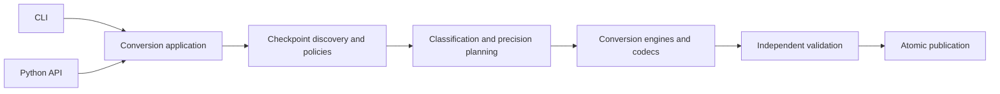

# Quantizer architecture

The release contains a Python library with a CLI adapter. Studio is deferred
and excluded from the source and wheel payloads. Backend code does not import the frontend, Textual,
or the root compatibility commands.



| Owner | Responsibility |
| --- | --- |
| `api.py`, `options.py` | Public operations and conversion requests without frontend state |
| `cli/` | Argument parsing, interactive setup, command presentation and process exit codes |
| `application.py` | Input resolution, pipeline orchestration, validation and publication decisions |
| `checkpoint_io/`, `files.py` | Checkpoint inventory, shards, tensor reads/writes, hashes and atomic file operations |
| `architectures/` | Model identification, architecture policies, key mapping and precision preservation |
| `formats.py`, `codecs/` | Native storage contracts, packing, rotation, encoding and bounded work |
| `planning/` | Classification, reconstruction/output metrics, sensitivity and mixed selection |
| `runtime/` | Kitchen API probes, target capabilities, certificates and measured kernel costs |
| `calibration.py`, `calibration_capture.py` | Calibration artifact validation and scoped activation capture |
| `metadata.py`, `reporting.py`, `events.py` | Portable provenance, reports and the neutral JSONL event protocol |
| `execution/` | Conversion execution and restart/resume state |
| `validation/` | Reference reconstruction, serialized layout checks and output verification |
| `testing/` | Regression checks and fixture data loaded only on explicit request |
| `config.py` | Validated XDG defaults for CLI/local frontend callers; library requests remain explicit |

## Dependency rules

Library modules import the modules that own the required operations. They never
import the CLI, application, TUI or compatibility facades. The application is the
composition point. Modules use explicit imports; the compatibility facade
resolves legacy names lazily.
Reference reconstruction remains separate from production encoding.

## Public use

The existing script works from a source checkout:

```sh
python comfyui_native_quantizer.py --list-formats
python -m native_quantizer --list-formats
```

Install the core in the Python environment that already supplies the intended
PyTorch build:

```sh
python -m pip install -e .
comfyui-native-quantizer --list-formats
```

Python callers use the public API:

```python
from native_quantizer import api
from native_quantizer.options import ConversionOptions

api.convert(ConversionOptions(
    model="input.safetensors",
    output="output-int8.safetensors",
    format="int8",
    max_memory="512M",
))
result = api.verify_output("output-int8.safetensors")
```

Conversion copies the request before normalizing it. Legacy Python names remain
available through `comfyui_native_quantizer.py`; new code should import the owning
module or use `api.py`. Tests that inject faults patch the consuming module.

## Preserved execution contracts

This restructuring preserves format bytes, policies, CLI options, quality gates
and publication behavior. W4A8, W6A8 and mixed conversions use the resumable
planned engine. The other native formats retain their atomic restart engine;
their existing unsupported options remain unsupported. Sharing modules does not
add resume or calibration support to those formats.

Working-memory limits cover temporary conversion work. Swizzled NVFP4/MXFP8
packing still requires a whole-layer budget. ComfyUI owns inference loading,
dispatch, residency and offloading; conversion validation does not certify full
model quality or performance.

## Validation

```sh
python comfyui_native_quantizer.py --self-test
python -m unittest -q test_quantizer_native.py test_kitchen_pipeline.py
python -m unittest -q test_architecture_detection.py test_quant_metadata.py test_w6a8.py test_project_structure.py
```

The architecture tests enforce frontend isolation, library boundaries, acyclic
imports, lazy fixture loading and equivalence between the typed API and CLI.
Linux CLI/configuration and source-change integrity tests are in
`test_linux_cli.py`. Registry coverage can be checked without importing ComfyUI
with `--audit-architectures COMFY_ROOT --json`.
