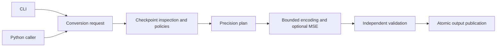

# Architecture and Python API

The library owns checkpoint conversion; the CLI translates arguments into the
same typed requests available to Python callers. Inference loading, dispatch,
residency and offloading belong to ComfyUI and Kitchen.



## Module ownership

Paths below are relative to `native_quantizer/`.

| Owner | Responsibility |
| --- | --- |
| `api.py`, `options.py` | Public operations, typed requests and option validation |
| `cli/`, `application.py` | CLI presentation and conversion orchestration |
| `checkpoint_io/`, `files.py` | Discovery, shards, bounded I/O, identities and publication |
| `architectures/` | Detection, component policies and key mapping |
| `formats.py`, `codecs/` | Layout contracts, encoding, packing and rotation |
| `optimization.py`, `codecs/optimization.py` | Optimizer configuration/provenance and native-grid searches |
| `planning/` | Metrics, sensitivity and mixed selection |
| `execution/` | Planned execution, streaming and resume journals |
| `runtime/` | Capabilities, Kitchen APIs, certificates and measured costs |
| `calibration.py`, `calibration_capture.py` | Recorded activation ingestion, caching and scoped capture |
| `metadata.py`, `reporting.py`, `events.py` | Native metadata, reports and JSONL events |
| `validation/` | Independent reconstruction and serialized output verification |
| `config.py` | Validated CLI defaults; API requests stay explicit |
| `testing/` | Fixtures and self-tests loaded only when requested |

Library modules import their owning dependencies directly. They do not import
application/command modules, optional frontends or root entry-point facades.
Reference decoders remain independent from production encoders. Lightweight API,
help and catalog imports avoid loading PyTorch and regression fixtures.

## Python use

```python
from native_quantizer import api
from native_quantizer.options import ConversionOptions

request = ConversionOptions(
    model="input.safetensors",
    output="output.safetensors",
    format="int8-convrot",
    optimizer="mse",
    mse_objective="weight",
    max_memory="512M",
    validate=True,
)
status = api.convert(request)
verification = api.verify_output("output.safetensors")
```

Conversion copies the request before normalizing execution options. It does not
read CLI preference files. `api.inspect_checkpoint`, `api.probe_runtime` and
`api.inspect_calibration` expose inspection operations. The script
`comfyui_native_quantizer.py` and `python -m native_quantizer` invoke the CLI;
Python integrations use `native_quantizer.api`.

## Execution contracts

W4A8, W6A8 and mixed conversions use a planned, resumable engine. Resume requires
matching source identities, options, layouts and staged data. MSE identities also
include the optimizer revision and selected activation contents.

INT8, W4A4, FP8, NVFP4, MXFP8 and precision casts use atomic restart. Native
formats accept recorded calibration for MSE optimization; controls belonging to
the planned engine remain explicitly rejected. Swizzled block formats require a
whole-layer budget; other applicable paths stream rows.

Independent validation runs before output publication. Its integrity,
reconstruction and consumer checks have distinct evidence boundaries described
in [validation](release-validation.md) and [support](support.md).

## Repository organization

`tests/cpu/` holds default CPU and opt-in consumer regressions; `tests/cuda/`
holds separately requested GPU checks. Shared isolation/consumer helpers are in
`tests/support.py`. `scripts/check.py` discovers CPU tests and runs each CUDA
suite in its own process when requested. Tests ship in the source archive and
are excluded from the installed wheel.

Architecture-specific guides live under `docs/models/`. Dependencies and extras
are declared once in `pyproject.toml`. Custom policy templates are generated by
`--write-architecture-template`, using the maintained schema. Root Python facades
are packaged compatibility interfaces; backend modules import owning modules.
